# Home Appliance Cards

Tíz Lovelace kártya a háztartáshoz és a garázshoz, közös alapokon:

| Kártya | Készülék | Integráció |
| --- | --- | --- |
| `custom:aeg-dishwasher-card` | AEG / Electrolux mosogatógép (fejlesztve: **GI8200X5TN**) | [TTLucian/ha-electrolux](https://github.com/TTLucian/ha-electrolux) |
| `custom:philips-airfryer-card` | Philips airfryer (fejlesztve: **HD9880 Combi 7000 XXL**) | [renaudallard/homeassistant_philips_homeid](https://github.com/renaudallard/homeassistant_philips_homeid) |
| `custom:skoda-car-card` | Škoda személyautó (fejlesztve: **Superb Combi**) | [skodaconnect/homeassistant-myskoda](https://github.com/skodaconnect/homeassistant-myskoda) |
| `custom:liebherr-fridge-card` | Liebherr hűtő / fagyasztó (fejlesztve: **Rd 5000-150 2**) | beépített [`liebherr`](https://www.home-assistant.io/integrations/liebherr) integráció |
| `custom:fisher-erv-card` | Hővisszanyerős szellőztető (fejlesztve: **Fisher F-ERVQ-B150CO2-I**) | [make-all/tuya-local](https://github.com/make-all/tuya-local) |
| `custom:daikin-ac-card` | Daikin klíma, egy gép vagy egy egész csoport (fejlesztve: **FTXC35**) | beépített [`daikin`](https://www.home-assistant.io/integrations/daikin) integráció |
| `custom:netatmo-heating-card` | Netatmo fűtés: termosztát, radiátorszelepek, ütemtervek | beépített [`netatmo`](https://www.home-assistant.io/integrations/netatmo) integráció |
| `custom:netatmo-weather-card` | Netatmo időjárás-állomás: kinti hőmérséklet, légnyomás, szobánkénti CO₂ | beépített [`netatmo`](https://www.home-assistant.io/integrations/netatmo) integráció |
| `custom:aeno-heater-card` | AENO infra fűtőpanel (fejlesztve: **AGH0001S**) | [make-all/tuya-local](https://github.com/make-all/tuya-local) |
| `custom:nanoleaf-shapes-card` | Nanoleaf Shapes világító panelek (fejlesztve: **Shapes Hexagons, NL42**) | beépített [`nanoleaf`](https://www.home-assistant.io/integrations/nanoleaf) integráció |

Mindegyik kártya animált rajzot és valós állapotkövetést ad, magyar és angol
nyelven, világos és sötét témában. A kilenc háztartási kártya vezérel is; **az
autó kártya szándékosan csak állapotot jelez**, szolgáltatást nem hív.

## Mosogatógép kártya

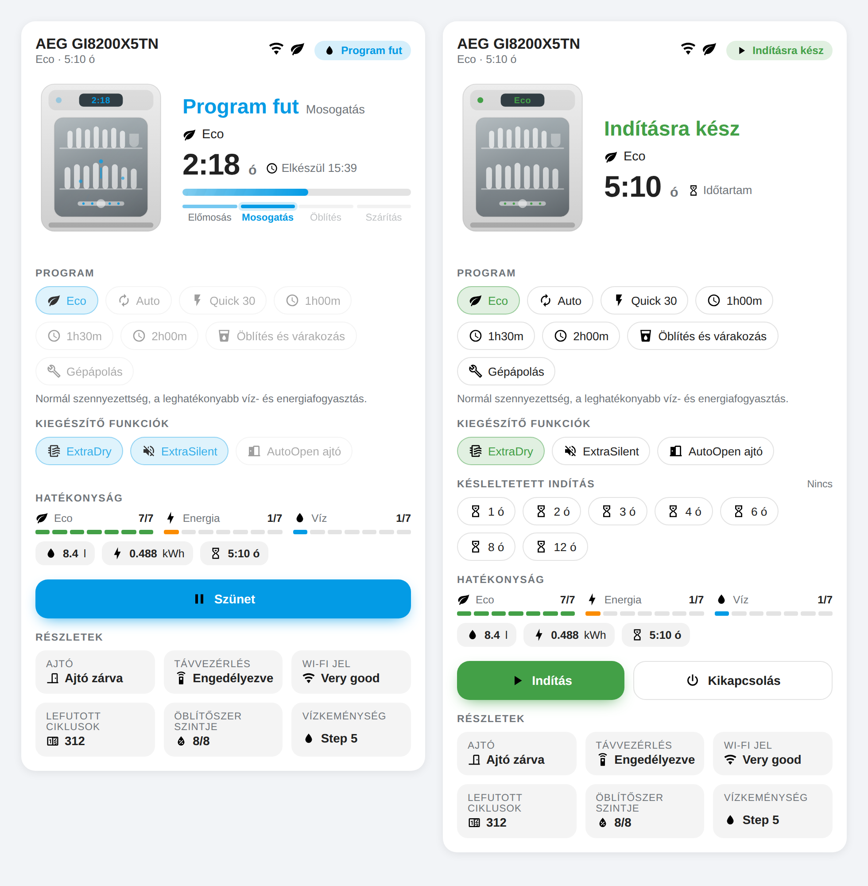

- **Animált géprajz**: mosogatás közben forgó szórókar, vízsugarak, hullámzó
  vízszint és felszálló buborékok, gőz a szárítási fázisban, csillogás a ciklus
  végén, a gép kijelzőjén a hátralévő idő.
- **Ajtó és bekapcsolt állapot a képen**: nyitott ajtónál a gép ajtaja lehajlik
  és árnyékot vet, kikapcsolt gépnél sötét a kijelző, a jelzőfény és a belső
  világítás is.
- **Mindig látszik, mikor lesz kész**: bekapcsolt gépnél a kártya akkor is
  kiírja a pontos befejezési időpontot (`Elkészül 19:51`), ha a program még el
  sem indult – a géptől kapott időtartamot használja, ami a bekapcsolt
  kiegészítő funkciókat (pl. ExtraDry, ExtraSilent) is tartalmazza, és csak
  ennek hiányában esik vissza a gépkönyv névleges idejére.
- **Futó ciklusnál** a hátralévő idő, a befejezés időpontja és egy
  előrehaladás-sáv. A gép nem küld százalékot, ezért a ciklus alatt látott
  leghosszabb hátralévő időből (illetve a program névleges hosszából) számol.
- **Fázis-idővonal**: Előmosás → Mosogatás → Öblítés → Szárítás; a program által
  nem használt fázisok halványak.
- **Programválasztó** a gépkönyv szerinti nevekkel, víz-/energiafogyasztással.
- **Kiegészítő funkciók** csak ott, ahol az adott program elfogadja őket.
- **Késleltetett indítás** három módon: gyorsgombok 1–12 óráig, ±10 perces
  léptető (a gép ekkora lépéseket fogad el, max. 24 óra), és **„Legyen kész"
  időpont** – megadod, mikorra kell elkészülnie, majd a pipára kattintva a
  kártya kiszámolja a késleltetést, 10 percre lefelé kerekítve (pl. 00:05-kor
  az 5:10-es Eco programmal 07:00-ra kérve 1:40 késleltetés lesz belőle). A
  beírt időpont addig marad, amíg meg nem erősíted. Mindig kiírja, hogy a gép
  mikor indul és mikor lesz kész (`Indul 16:28 · Elkészül 21:38`).
- **Kikapcsolt gépnél nincs félrevezető adat**: nincs kiválasztott program,
  futásidő, kiegészítő funkció és hatékonysági mérce – a programválasztó
  inaktív, a riasztások, a készülékbeállítások és a részletek maradnak.
- **Riasztások magyarul**: sóhiány, öblítőszer-hiány, i10/i20/i30/iF1 hibakódok
  – a kódokat az `alerts` szenzor attribútumaiból olvassa ki (az állapota csak
  a riasztások darabszáma).
- **Eco/energia/víz pontszámok a géptől**, programonként: az Öblítés és
  várakozás, illetve a Gépápolás programnál a gép nem küld pontszámot, ott a
  kártya el is rejti őket; programváltás után pedig halványan jelzi, hogy még a
  régi értékek látszanak, amíg a gép ki nem számolja az újakat.
- Ciklusszám, öblítőszerszint, vízkeménység, Wi-Fi jelminőség, távvezérlés
  állapota.

Részletek: [`docs/dishwasher-capabilities.md`](docs/dishwasher-capabilities.md),
példák: [`examples/dishwasher.yaml`](examples/dishwasher.yaml).

## Airfryer kártya

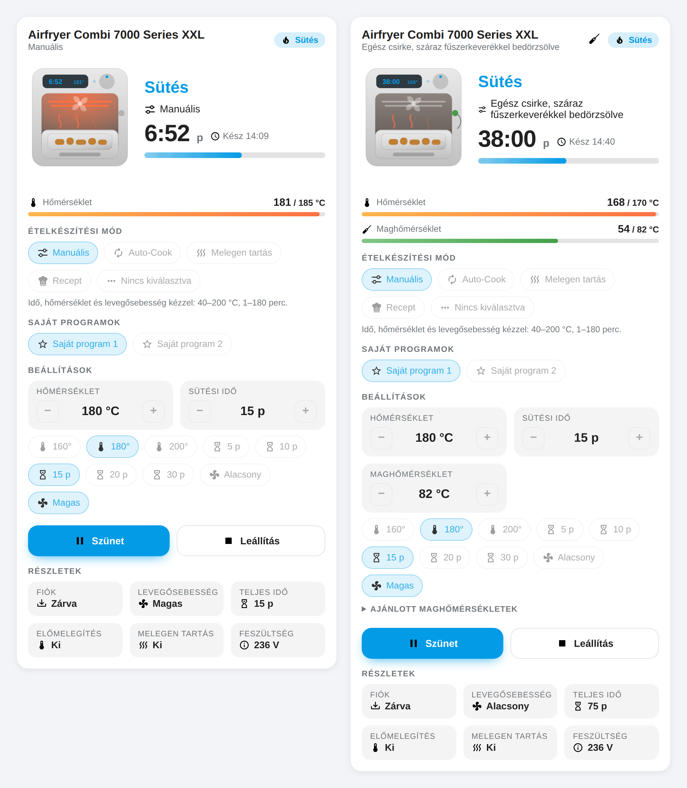

- **Animált géprajz**: pörgő ventilátor, izzó fűtőszál, felszálló hő, gőz a
  párolós módokban, pirulő étel.
- **Nyitott / csukott fiók a képen**: csukva egybefüggő előlap, nyitva a fiók
  kicsúszik a néző felé, árnyékot vet, mögötte sötét rés, és felülnézetből
  látszik a kosár a benne lévő étellel. Ugyanez megjelenik figyelmeztető sávként
  (sütés közben „a fiók nyitva – a sütés szünetel”), fejlécikonként és a
  Részletek között; nyitott fióknál az indítás gomb le van tiltva.
- **Rázás- és fordításemlékeztető animációval**: a fiók rázkódik, az étel
  ugrál benne, a fiók körvonala felvillan, mellé villogó figyelmeztető sáv
  (manuális módban a beállított idő felénél szól a gép).
- **Hátralévő idő** perc:másodperc pontossággal, pontos befejezési időponttal és
  előrehaladás-sávval (a gép a teljes és a hátralévő időt is küldi).
- **Hőmérséklet-mérő**: aktuális / cél, és **ételhőmérő** esetén a maghőmérséklet
  külön mérővel, valamint a gépkönyv ajánlott maghőmérséklet-táblázatával.
- **Ételkészítési módok és saját programok** választása, hőmérséklet/idő/
  maghőmérséklet állítása léptetőkkel és gyorsgombokkal, levegősebesség.
- **Állapotfüggő vezérlés**: bekapcsolás, indítás, szünet, leállítás, melegen
  tartás.

Részletek: [`docs/airfryer-capabilities.md`](docs/airfryer-capabilities.md),
példák: [`examples/airfryer.yaml`](examples/airfryer.yaml).

| Sötét téma | Mobil / kompakt |
| --- | --- |
| 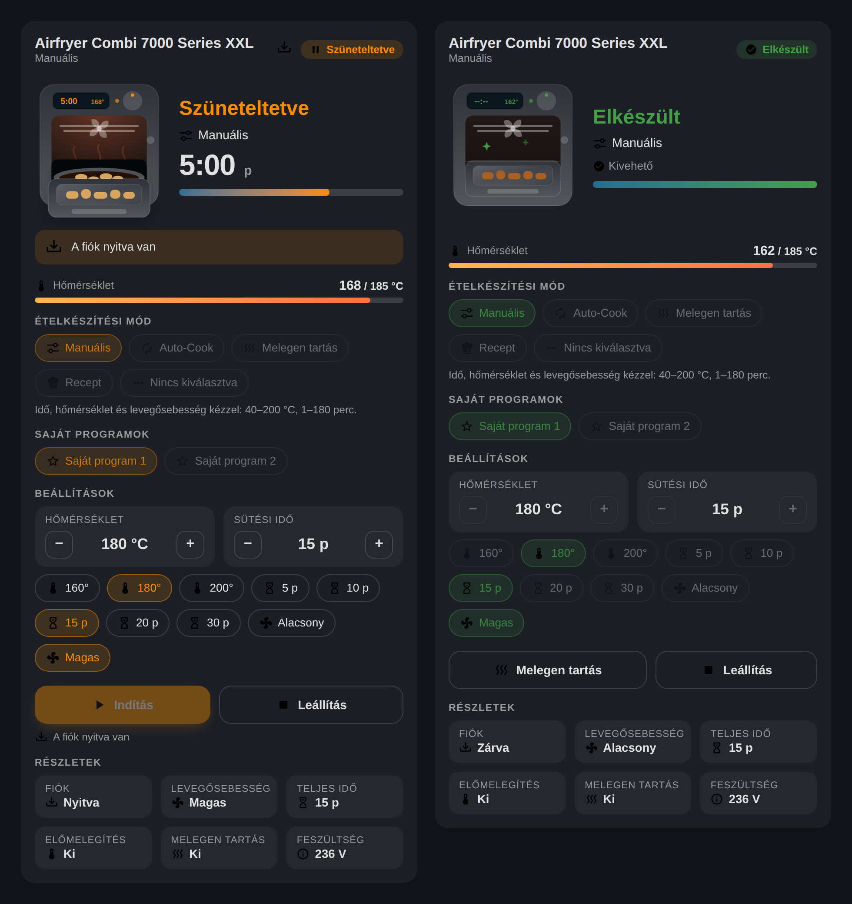 | 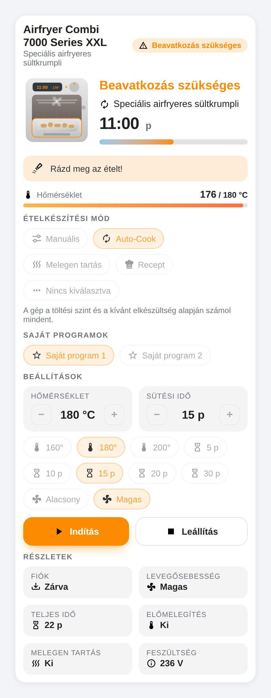 |

## Autó kártya

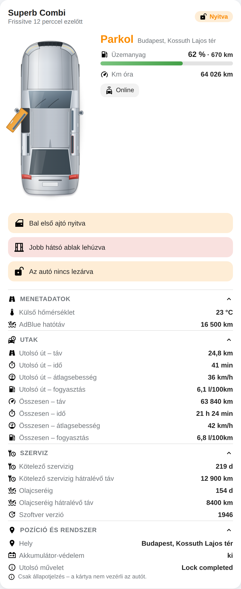

**Csak állapotjelzés – a kártya nem vezérli az autót.** Egyetlen interakció van:
egy sorra kattintva megnyílik az adott entitás adatlapja.

- **Felülnézeti rajz**: kombi arányokkal rajzolt SVG (tetősín, panorámatető,
  ablaktörlők, antenna, kilincsek, lámpák, rendszámtábla-hely, tanksapka), a
  témához igazodó fényezéssel.
- **Animált ajtónyitás**: nyitott ajtónál a lap a zsanér körül kifordul,
  sárgára vált, és alatta látszik a sötét ajtónyílás.
- **Lehúzott ablak pirosan**: az érintett ajtó ablaka piros és villog.
- **Csomagtartó és motorháztető** felnyílik, alatta a sötét csomag-, illetve
  motortér; **parkolófénynél** felizzanak a lámpák; **offline** autónál a rajz
  kiszürkül.
- **Műszerfal elrendezés**: fejlécben a név és a jármű leírása (modell +
  évjárat, `subtitle:`-lel átírható), mellette a zárás; az autó mellett nagy
  állapotfelirat (Parkol / Úton / Nem elérhető), üzemanyagszint-csík a
  hatótávval (25 % alatt sárga, 10 % alatt piros), km óra, külső hőmérséklet,
  AdBlue és a szervizig hátralévő idő.
- **Három összegző panel** a figyelmeztetések alatt: Szerviz, Utolsó út,
  Pontszám (ez utóbbi saját, pl. template szenzorokból), a lábléc pedig a
  parkolási helyet és az adat korát mutatja.
- **Figyelmeztetések**: nyitott ajtó/ablak/csomagtartó/motorháztető, lezáratlan
  autó, égve maradt parkolófény; kettőnél többnél összevont sor („4 ajtó nyitva”).
- **Nyitható szekciók**: Menetadatok, Összesített utak, Szerviz, Töltés
  (elektromos modelleknél), Klíma, Pozíció és rendszer. A `show_extra: true`
  minden további MySkoda szenzort is kilistáz.

Részletek: [`docs/car-capabilities.md`](docs/car-capabilities.md),
példák: [`examples/car.yaml`](examples/car.yaml).

| Sötét téma | Minden nyitva |
| --- | --- |
| 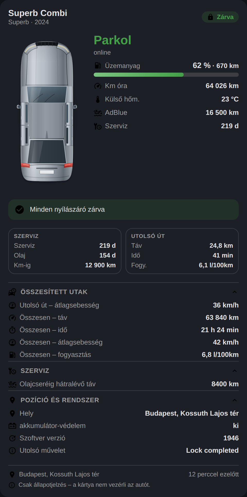 | 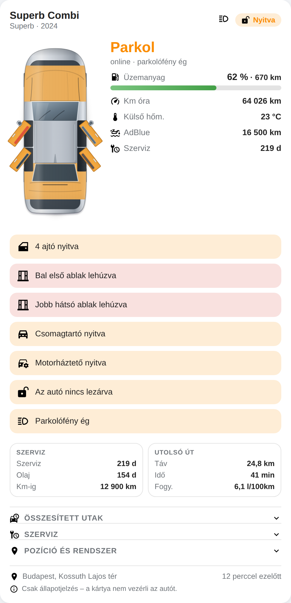 |

## Hűtő kártya

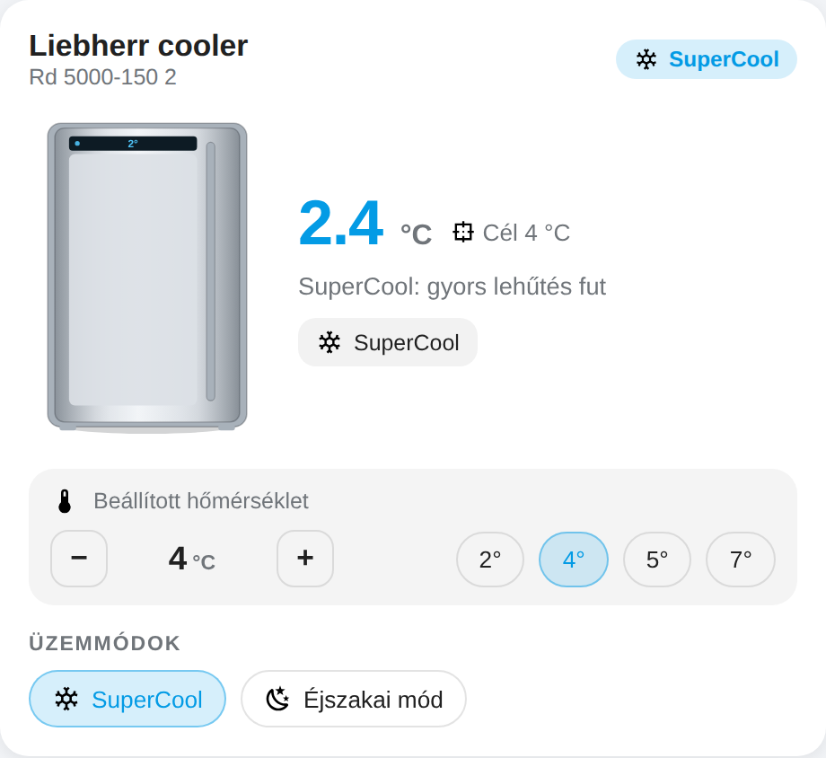

- **Animált készülékrajz**: annyi ajtó, ahány zónát a gép jelent (1–3);
  hűtés közben hideg levegő áramlik a belső térben, SuperCool / SuperFrost
  alatt kékre vált és hópelyhek szállnak, éjszakai módban elhalványul a
  kijelző, a belső világítás meleg fénnyel tölti meg a teret. Az aktuális
  hőmérséklet az ajtó kijelzőjén is látszik.
- **Hőmérséklet-állítás zónánként**: −/+ léptető a gép saját tartományában és
  lépésközével, mellette gyorsgombok (a fagyasztó tartományán kívül esők nem
  jelennek meg).
- **Üzemmódok**: SuperCool, SuperFrost, éjszakai mód, PartyMode, belső
  világítás; **BioFresh-Plus, HydroBreeze és jégkészítő** választósorral,
  zónánként.
- **Állapotsor**: hőmérsékleten van-e, mennyivel tér el a beállítottól, illetve
  hogy épp gyorshűtés fut.
- **Ajtónyitás**: a Liebherr API nem ad ajtó-entitást (az app riasztásai más
  csatornán jönnek), de a kártya bármilyen ajtó-szenzort elfogad
  (`entities: { door: binary_sensor.… }`), és ahol van AutoDoor, azt magától
  használja: nyitott ajtónál a rajzon kinyílik az ajtó, és figyelmeztető sor
  jelenik meg.

Részletek: [`docs/fridge-capabilities.md`](docs/fridge-capabilities.md),
példák: [`examples/fridge.yaml`](examples/fridge.yaml).

| Nyitott ajtó | Sötét téma | Hűtő-fagyasztó (két zóna) |
| --- | --- | --- |
| 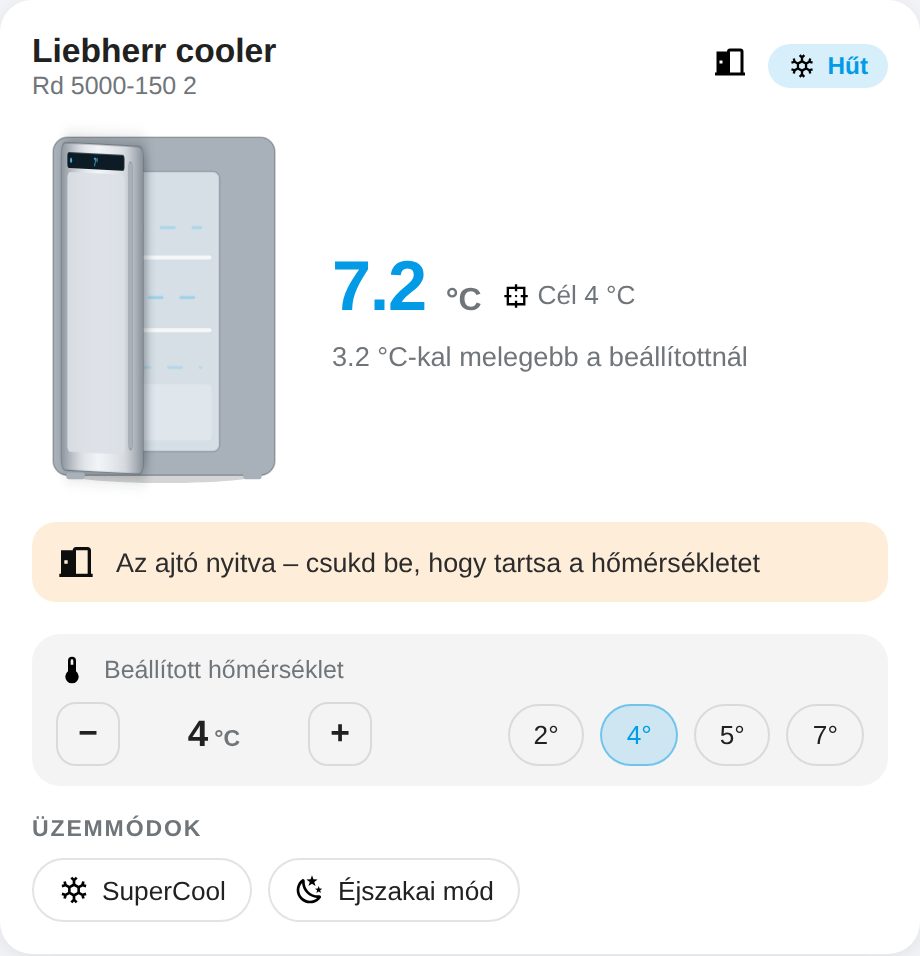 | 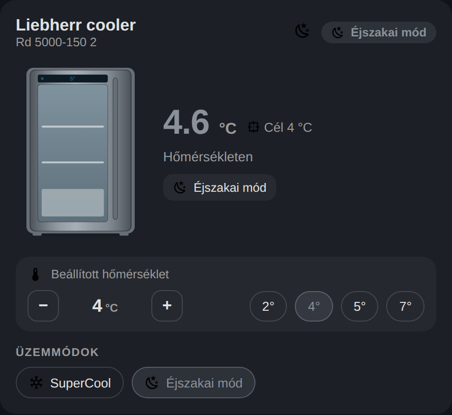 | 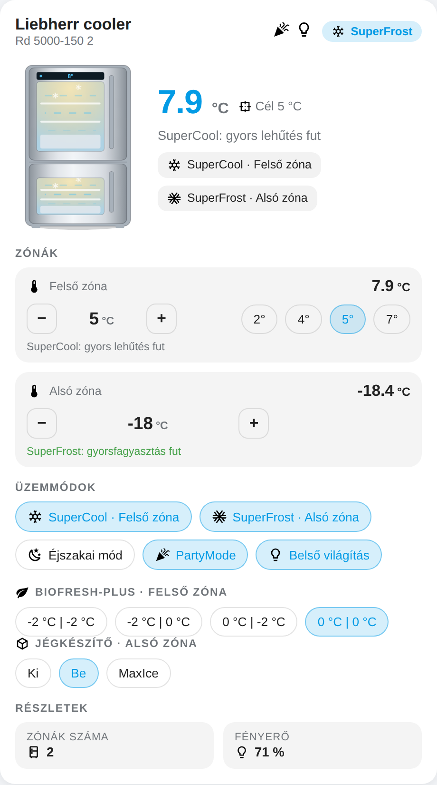 |

## Szellőztető kártya

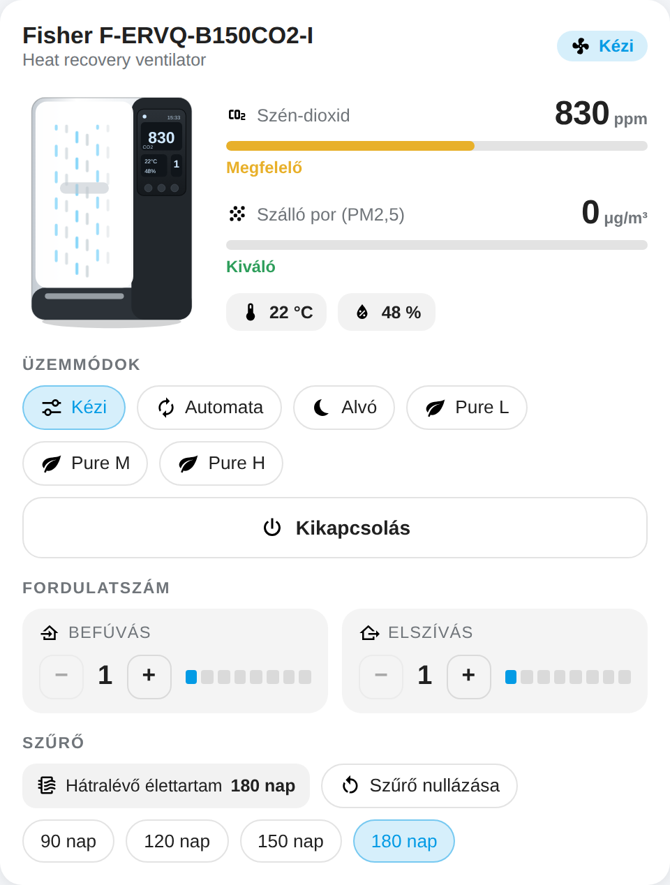

- **Animált készülékrajz**: a valódi előlap a jobb oldali kijelzővel, amin
  ugyanaz látszik, mint a gépen – nagy CO₂ érték, alatta hőmérséklet és
  páratartalom, mellette a fordulatszám számjegye. A fehér előlapon friss és
  elhasznált levegő áramlik, a sebesség a befúvó fokozatát követi; kikapcsolt
  gépnél megáll és a kijelző elhalványul.
- **Levegőminőség**: CO₂ és PM2,5 színsávval és szöveges minősítéssel
  (Kiváló → Rossz), mellette hőmérséklet és páratartalom. Magas CO₂-nél
  figyelmeztet.
- **Álló gépnél nem minősít.** A gép csak akkor méri a levegőt, amikor
  mozgatja is: kikapcsolva 0 ppm-et küld, miközben a hőmérséklet és a
  páratartalom valódi marad. Egy szoba CO₂-je viszont soha nem nulla, így ez
  nem alacsony érték, hanem hiányzó mérés – a kártya ezért ilyenkor kiírja,
  hogy nem mér, ahelyett hogy „Kiváló"-t mondana.
- **Üzemmódok**: a gép által kínált presetek (Kézi, Automata, Alvó, Pure L/M/H)
  és a be-/kikapcsolás; **fordulatszám** befúvásra és elszívásra külön (1–8).
- **Szűrő**: hátralévő élettartam, nullázó gomb, élettartam-választó; lejáró
  szűrőnél figyelmeztet, és a rajzon is jelzi.

Részletek: [`docs/erv-capabilities.md`](docs/erv-capabilities.md),
példák: [`examples/erv.yaml`](examples/erv.yaml).

| Szellőztet (magas CO₂) | Hiba + lejáró szűrő |
| --- | --- |
| 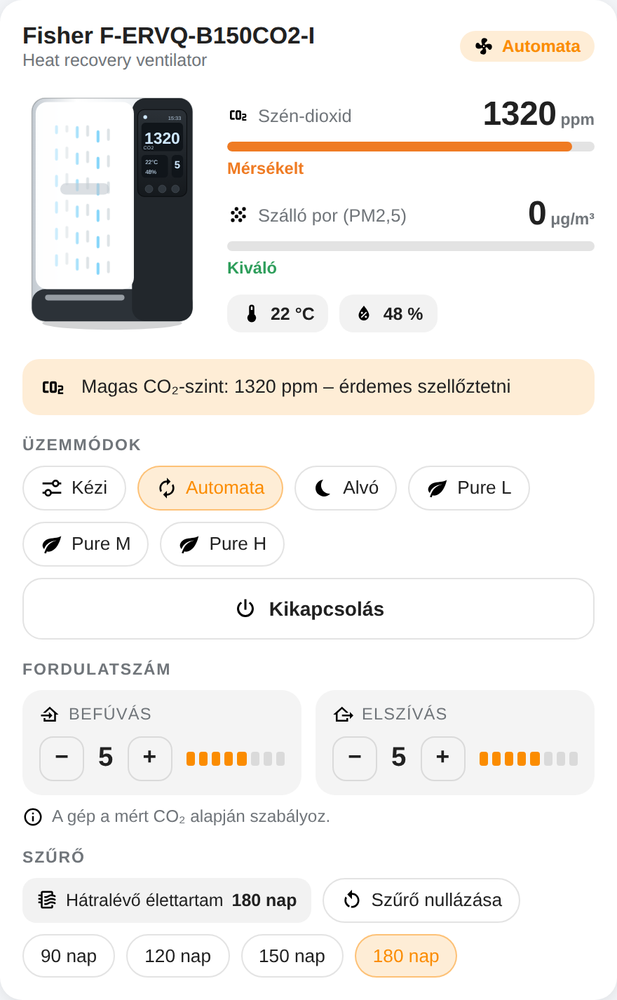 | 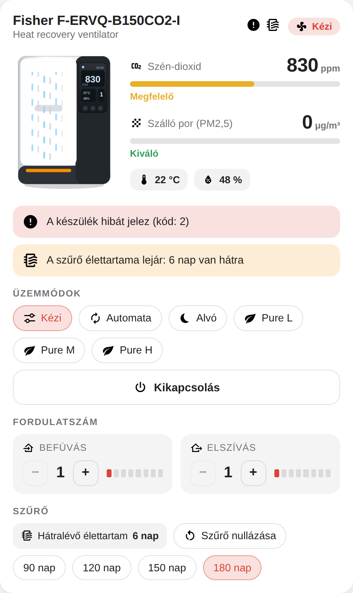 |

## Klíma kártya

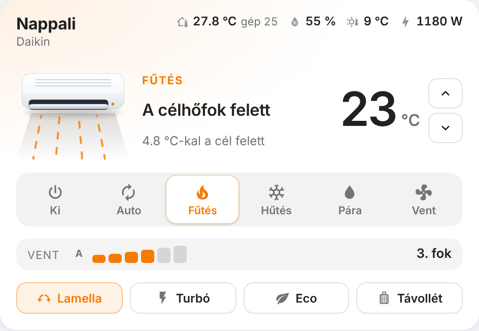

- **Sűrű elrendezés**: fejléc a mért értékekkel, egy hero sor a rajzzal, az
  állapottal és a nagy célhőmérséklettel, alatta szegmentált üzemmód-sáv,
  ventilátor-ticksor és a kapcsolók. Egy képernyő, görgetés nélkül.
- **Animált készülékrajz**: a lamella elölnézetben lebillen és „rövidül",
  mögötte előbújik a sötét kifúvó; a légáram színe a mód (fűtés narancs, hűtés
  kék, párátlanítás türkiz), a sebessége a ventilátor fokozata. A mód színe
  végigfut az egész kártyán.
- **Szobában mérő hőmérő**: a `sources.temperature`-rel megadott szenzor
  veszi át a gép saját hőmérőjének helyét – az a beltéri egység beszívójában
  ül, és fűtésnél többet, hűtésnél kevesebbet mutat a valóságnál. A gép értéke
  halványan mellette marad.
- **Fogyasztásmérő**: 100 W alatt a kártya kimondja, hogy a kompresszor áll és
  csak a ventilátor forog – ezt a Daikin saját szenzorai nem árulják el.
- **Csoport egy kártyán**: egy `climate_group` entitást megadva minden gép egy
  sor, saját animált rajzzal; a sorra koppintva helyben nyílnak a vezérlői.
  Vegyes üzemnél a kártya nem tesz úgy, mintha a gépek egyformán állnának.
- **Nyitott ablak**: ha a gép nyitott ablakba fűt vagy hűt, a kártya szól, és
  megmondja, mióta. Nem kell felsorolni semmit – a párosítás a klíma
  **területe** alapján megy. Álló gépnél csak halvány jelvény, csak
  keringetésnél semmi: az nem kerül pénzbe. A bukó-nyíló ablak két kontaktusa
  egy ablak, és a kártya kimondja, ha csak **bukóra** van.

Részletek: [`docs/daikin-capabilities.md`](docs/daikin-capabilities.md),
példák: [`examples/daikin.yaml`](examples/daikin.yaml).

| Négy gép egy kártyán | Kinyitott gép | Nyitott ablak | Sötét téma |
| --- | --- | --- | --- |
| 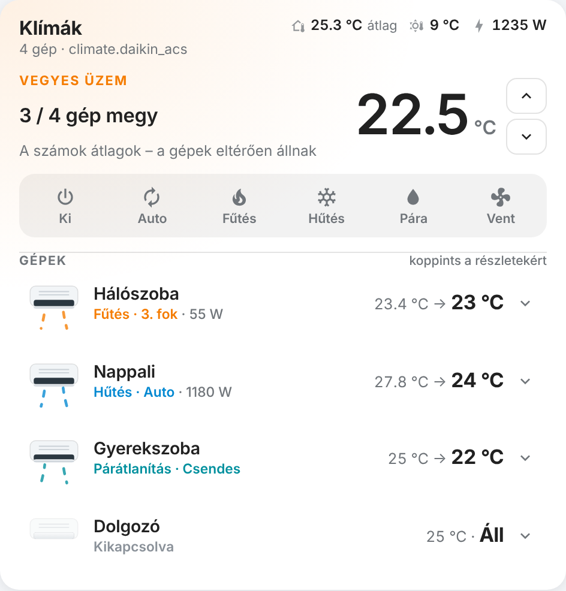 | 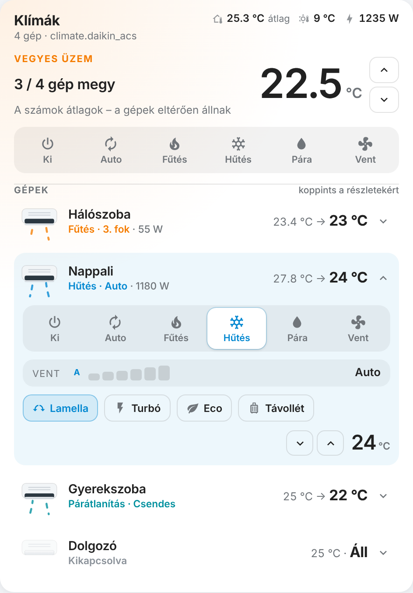 | 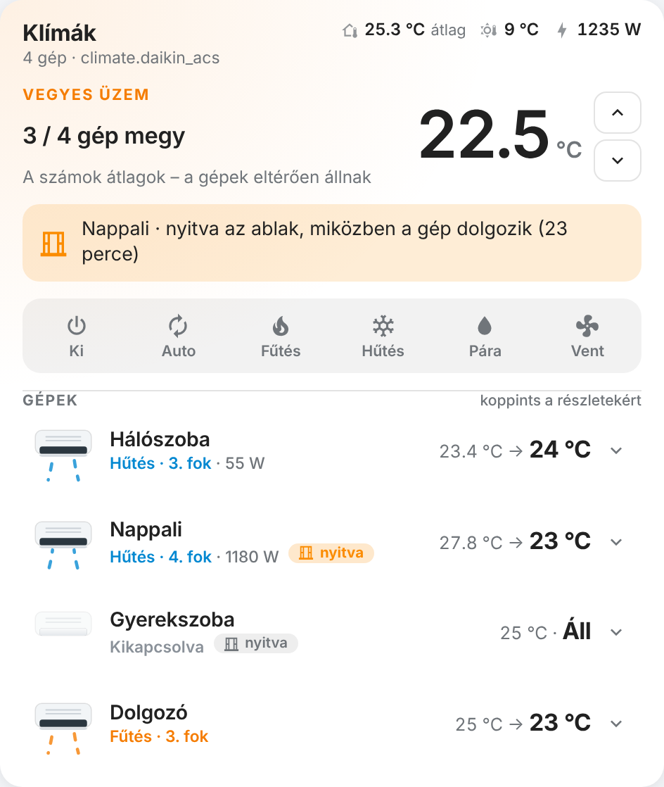 | 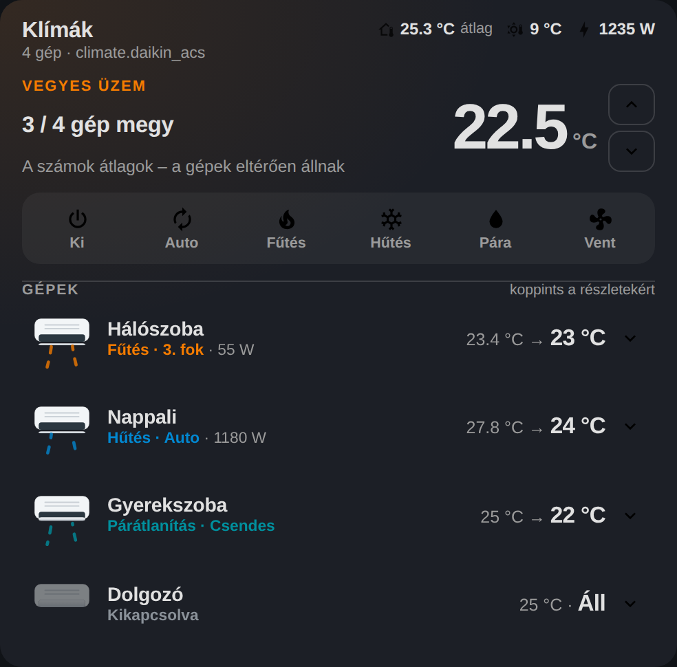 |

## Fűtés kártya

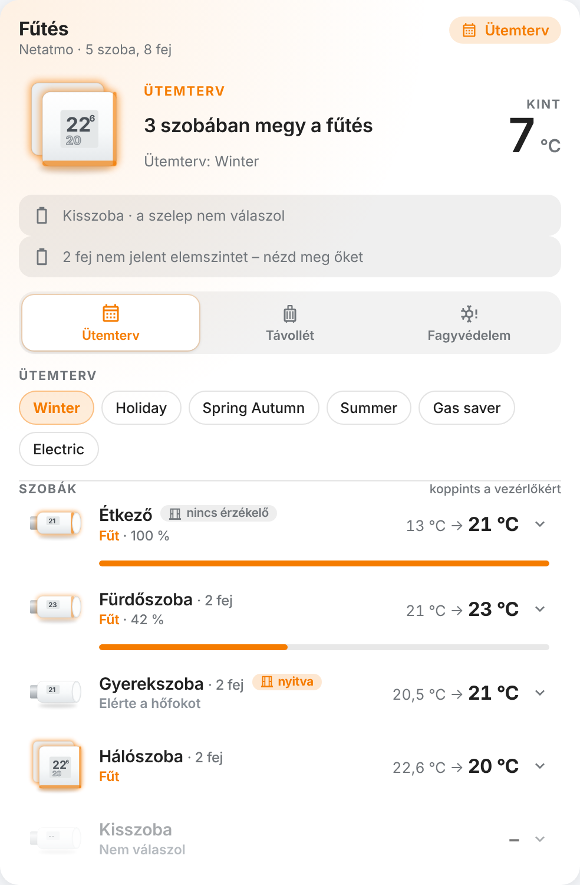

- **A készülékek világítanak, amikor fűtenek** – a termosztát a peremén, a
  szelepek a fedél mögötti gyűrűn, ahogy a valódi eszközök. A fény erőssége a
  szoba fűtési igényét követi (`heating_power_request`, 0–100 %), és a sor
  alatt vékony sáv is mutatja.
- **A termosztát külön eset**: a Smart Thermostat nem jelent fűtési igényt, a
  kulcs egyszerűen hiányzik. A kártya ezt nem nullának veszi, hanem a
  `hvac_action`-re vált – százalék nélkül, de világítva.
- **Házmód egy sávban**: Ütemterv / Távollét / Fagyvédelem, alatta a mentett
  ütemtervek. Fagyvédelemben az egész kártya kékre vált és kimondja, hogy a
  fűtés áll – ez a leggyakoribb „miért hideg a ház" ok.
- **Nyitásérzékelők**: terület alapján magától párosítja őket a szobákhoz, és
  **csak akkor figyelmeztet, ha a szoba épp fűt**. Ahol nincs érzékelő, azt is
  kiírja, nem tesz úgy, mintha zárva lenne.
- **Bukó-nyíló ablakot egynek számol**: ha egy szárnyon két kontaktus van,
  felül és alul, az egy ablak. Csak a felső nyitva = **bukóra** van, mindkettő
  = teljesen nyitva – a sarkig kitárt ablak nem „2 nyitva".
- **Egy szoba külön kártyán**: add meg a szoba entitását (vagy válaszd ki az
  eszközt a szerkesztőben), és a kártya szobakártyává alakul – a szoba saját
  hőmérséklete nagyban, a saját eszköze rajzolva, a fűtési igénye sávval,
  rögtön elérhető hőfokállítással. A házmód látszik rajta, de nem vezérlő:
  egy szoba csempéjéről az egész házat átbillenteni könnyű baleset.
- **Elemszintek fejenként**, saját címkével – a Netatmo friendly_name-jei
  ütköznek, az azonosítóból viszont megkülönböztethetők („ablak",
  „slim radiator").

Részletek: [`docs/netatmo-heating-capabilities.md`](docs/netatmo-heating-capabilities.md),
példák: [`examples/netatmo-heating.yaml`](examples/netatmo-heating.yaml).

| Egy szoba kártyája | Nyitott ablak fűtés közben | Fagyvédelem | Sötét téma |
| --- | --- | --- | --- |
| 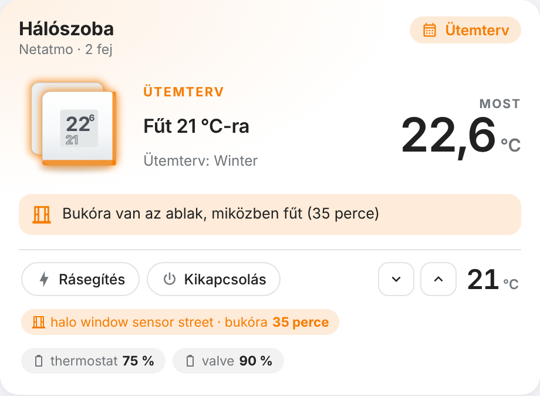 | 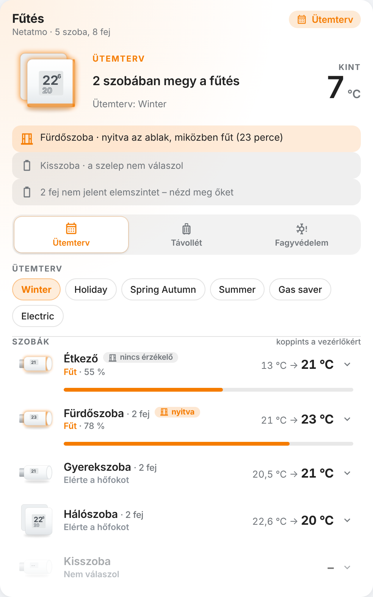 | 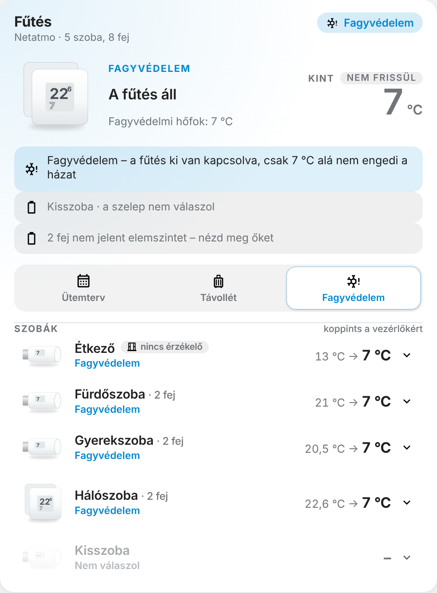 | 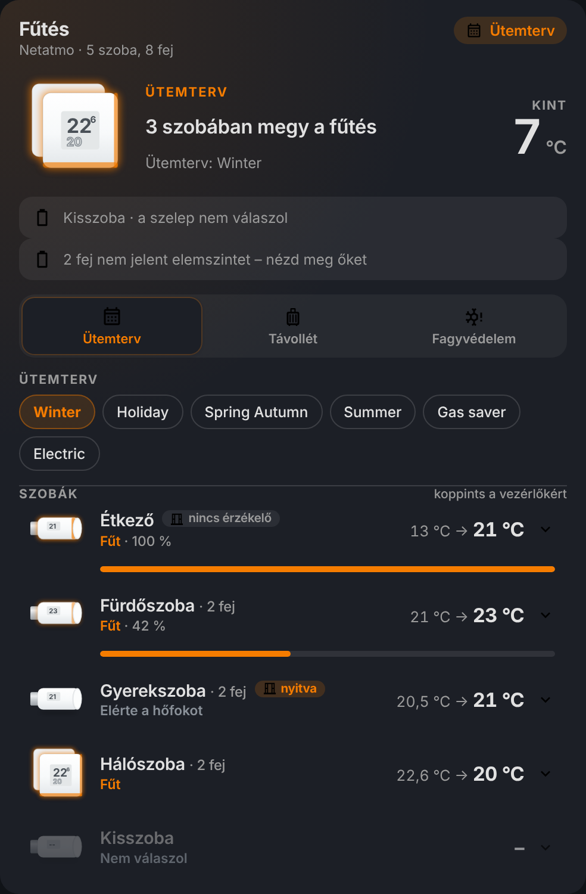 |

## Időjárás-állomás kártya

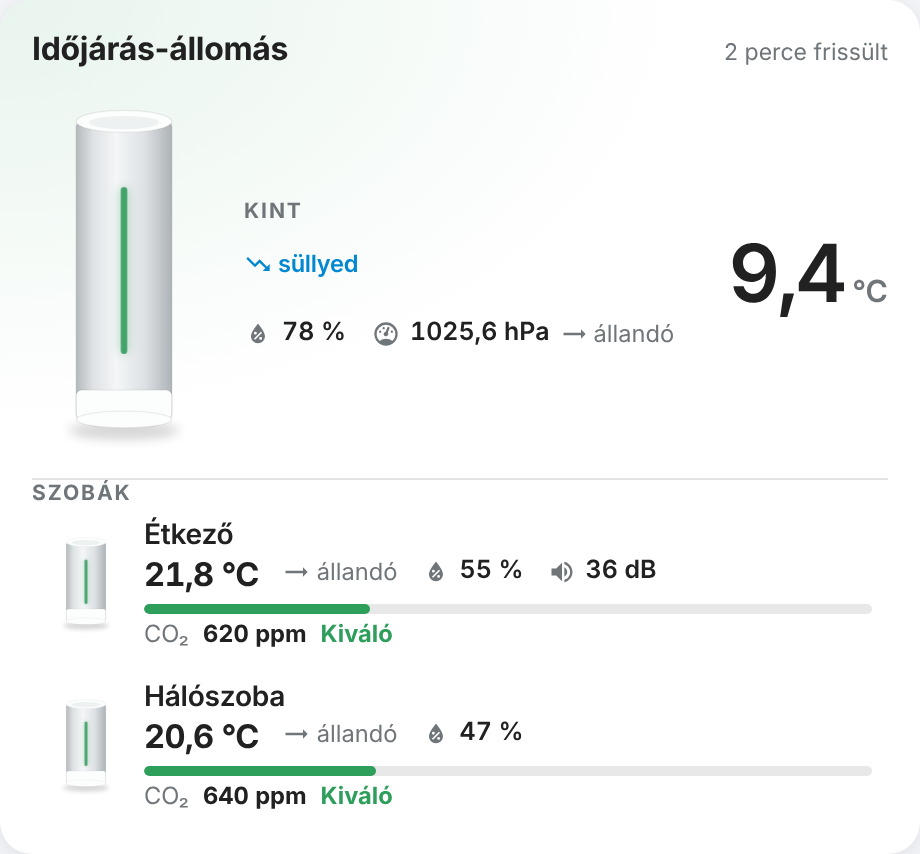

- **Három állapot modulonként, nem kettő.** Ha egy Netatmo modul lejön a
  rádióról, nem megy „unavailable" állapotba: órákon át közli az utolsó
  mérését, mintha friss lenne. A kártya ezért külön kezeli az **élő**, a
  **nem frissül** (befagyott értékek, „nem frissül" jelvénnyel, mérősáv
  nélkül) és a **nem válaszol** (lemerült elem) esetet. Egy tegnapi 1800 ppm
  nem festheti pirosra a kártyát.
- **Kint, nagyban**: a kültéri hőmérséklet trendnyíllal, mellette a
  páratartalom és az alapegység légnyomása a saját trendjével.
- **A rés világít**: az alapegység hengerén a hosszú rés a legrosszabb élő
  szoba levegőjét mutatja – pont azt csinálja, amit a valódi gép, ha ráteszed
  a kezed a tetejére.
- **Szobánkénti CO₂** öt sávos mérőszalaggal és felirattal. A rajzon viszont
  csak három szín van: a valódi gép is ennyit mutat, és öt, egymáshoz közeli
  árnyalatot egy ilyen kis hengeren színtévesztő látással nem lehetne
  megkülönböztetni.
- **Nem a nevéből tudja, melyik modul melyik**: az alapegységen van
  légnyomásmérő, a beltéri modulon CO₂, a kültérin egyik sem. A fűtési
  szelepek ugyanezen a platformon vannak, de csak elemszenzort hoznak létre,
  ezért maguktól kiesnek.
- **A követett publikus állomások ki vannak zárva**: ugyanazzal a
  device_class-szal jönnek, mint a saját hardvered, légnyomással együtt –
  bent hagyva a kártya egy idegen kertet mutatna a házadként.

Részletek: [`docs/netatmo-weather-capabilities.md`](docs/netatmo-weather-capabilities.md),
példák: [`examples/netatmo-weather.yaml`](examples/netatmo-weather.yaml).

| Leszakadt kültéri modul | Rossz levegő | Néma modul | Sötét téma |
| --- | --- | --- | --- |
| 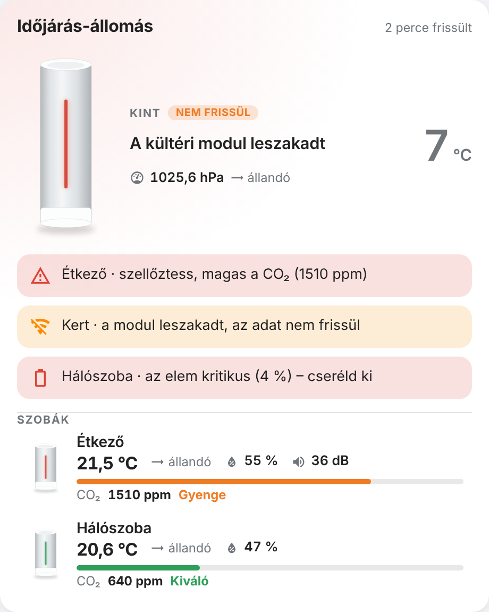 | 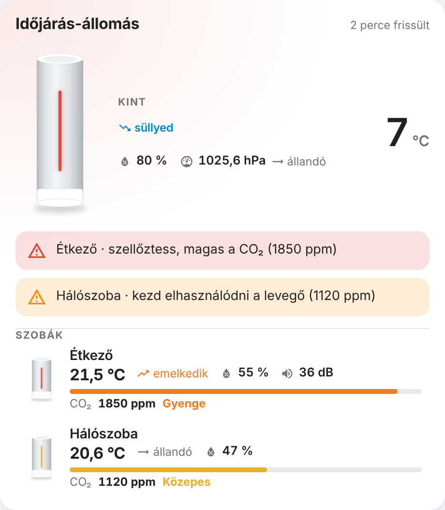 | 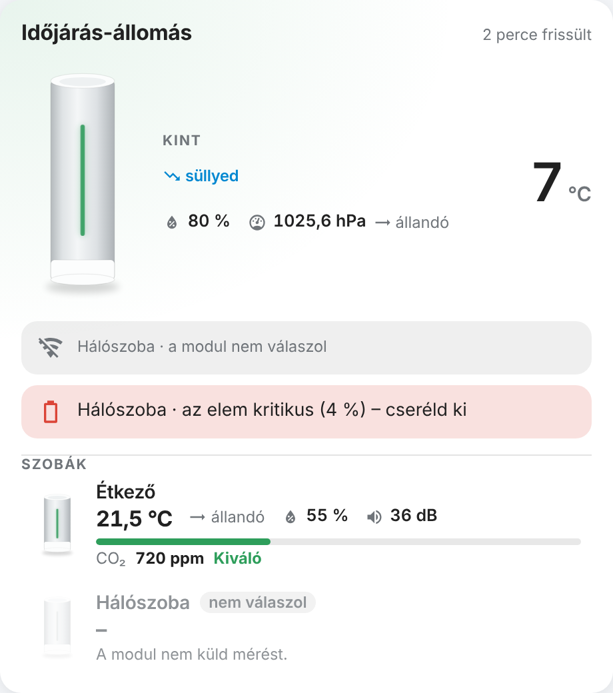 | 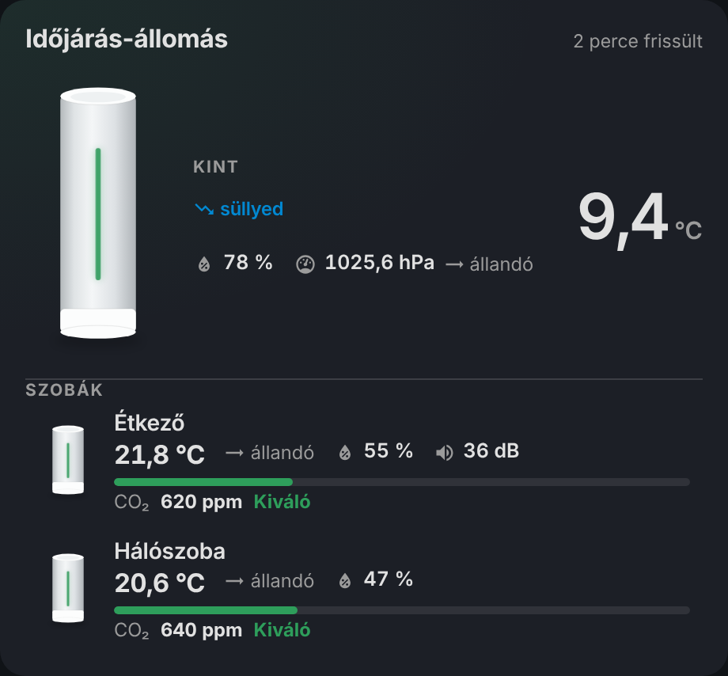 |

## Infrapanel kártya

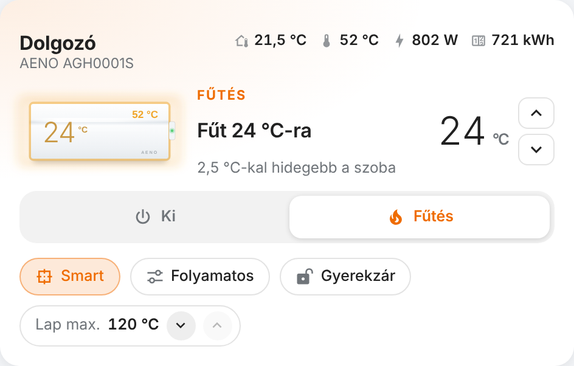

- **A panel úgy rajzolva, ahogy a falon van**: láb nélkül, a vezérlődobozzal a
  jobb szélen. Infrapanel, tehát a hőt a lap **síkjából kifelé** sugározza, nem
  felszálló légárammal – a rajzon ezért meleg glória veszi körbe, és abból
  indulnak kifelé a hullámok, nem fölfelé.
- **Két szám a panelen**: a beállított hőfok nagyban, a lap saját
  hőmérséklete kicsiben. A valódi gépen nincs kijelző, ezért egyik sem világító
  számként kerül rá, hanem az üvegbe maratva – a kártya kiegészítése, nem
  hardver.
- **A keret színe a lap hőmérséklete**, 0-tól 120 °C-ig skálázva: hideg lapnál
  az alumínium szürkéje, 70-nél narancs, 120-nál vörös. Ránézésre látszik,
  mennyire forró a panel, szám elolvasása nélkül.
- **A szín és a mozgás külön beszél.** A keret színe azt mondja, mennyire meleg
  a lap, a pulzálás és a kifelé induló hullámok azt, hogy megy-e az elem. Egy
  tíz perce lekapcsolt panel forró, de áll; egy perce bekapcsolt még hideg, de
  dolgozik – és a kép mindkettőt pontosan mondja.
- **A Folyamatos mód csapdáját kimondja.** A panel Smart módban követi a
  beállított hőfokot, Folyamatosban viszont **nem veszi figyelembe** – ott
  felejtve egész nap fűt. Ez nem egy megnyomott gomb a kártyán, hanem külön
  figyelmeztetés.
- **Nyitott ablak**: a párosítás a panel **területe** alapján megy, felsorolni
  nem kell semmit. A bukó-nyíló ablak két kontaktusa egy ablak, és a kártya
  kimondja, ha csak **bukóra** van. Álló panelnél csak halvány jelvény: az nem
  kerül pénzbe.
- **A nevéből nem indul ki semmi.** Mindkét panel ugyanazt a friendly_name-et
  adja („AENO Smart Heater"), ezért a kártya címe a terület neve, és két panel
  esetén inkább megkérdezi, melyikről szóljon, mint hogy találomra válasszon.
- **Gyerekzár, a lap max. hőfoka, időzítő** – ezek csak a panel saját
  eszközprofiljával léteznek. A gyári `princess_panel_heater` profillal a
  kártya csendben elhagyja őket, nem mutat halott vezérlőket.

Részletek: [`docs/aeno-capabilities.md`](docs/aeno-capabilities.md),
példák: [`examples/aeno.yaml`](examples/aeno.yaml).

| Folyamatos mód | Nyitott ablak | Időzítő | Gyári profil | Sötét téma |
| --- | --- | --- | --- | --- |
| 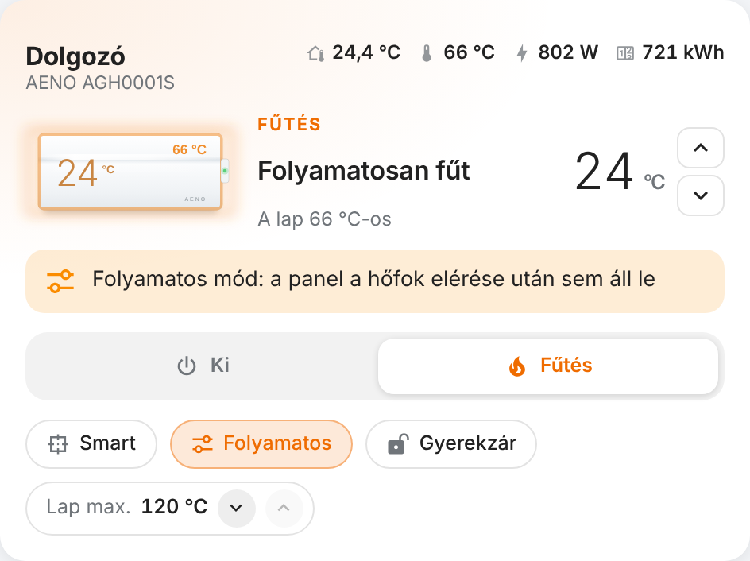 | 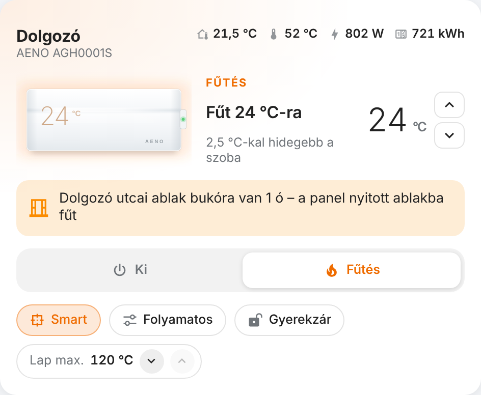 | 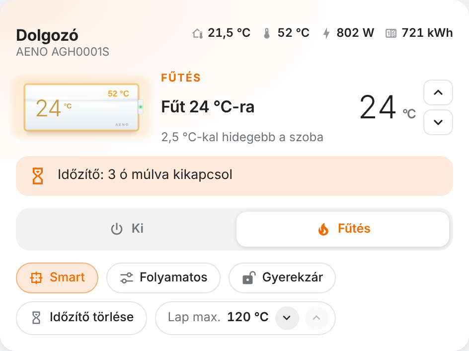 | 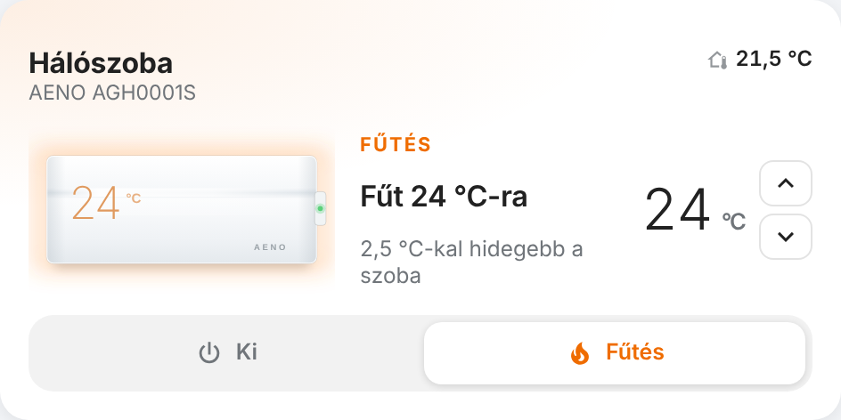 | 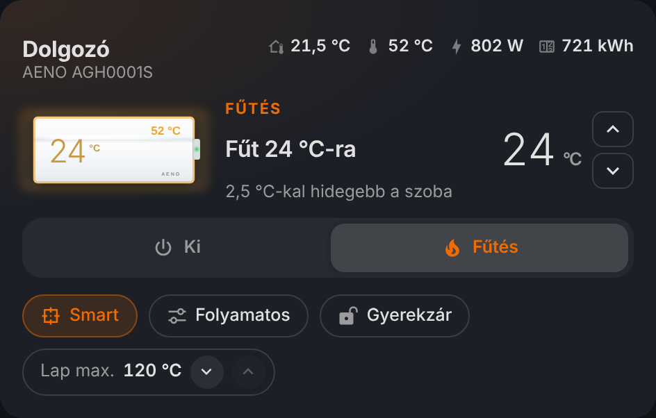 |

## Nanoleaf Shapes kártya

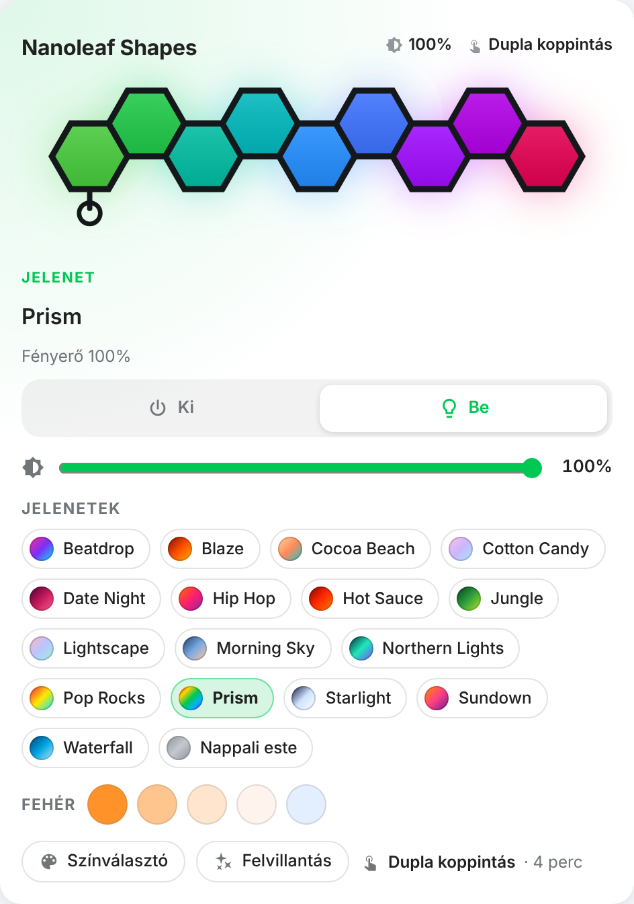

- **A panelek a saját elrendezésükben.** Az integráció a panelek számát és
  elhelyezkedését nem adja át, pedig a Nanoleaf API tudja – a kártya ezért a
  configból veszi, hatszög-koordinátákban, és azt rajzolja, ami tényleg a
  falon van. Fekete kerettel, mert a Shapes Black pont így néz ki.
- **A futó jelenet végigfut a falon**: minden panel kicsit később kezdi
  ugyanazt a színciklust, a helyzete szerint – ahogy a valódi panelek is.
- **Effekt közben a szín nem jelent semmit, és a kártya tudja.** A Home
  Assistantnak nincs „effekt" színmódja, ezért a lámpa `hs`-t jelent, és az a
  legutóbbi fix szín: Prism közben `hue: 0, saturation: 0`, azaz fehér. Abból
  festve a kártya üres falat mutatna szivárvány alatt – ezért **előbb az
  effektet nézi**, és a színt csak akkor, ha nincs futó jelenet.
- **A jelenetek színmintával.** A HA csak a nevüket kapja meg, se palettát, se
  előnézetet – enélkül a választó tizenhat egyforma szövegsor lenne. A kártya
  ezért saját színmintát tart a gyári jelenetekhez; ami nincs köztük (saját
  készítésű jelenet), az semleges mintát kap, és kimondja, hogy nem ismeri.
- **Érintés csak ott, ahol van.** Az integráció `event` entitást csak a
  Canvas, a Shapes Hexagons és az Elements modellekre hoz létre – a kártya a
  Triangles-nél elhagyja a sort, nem mutat sosem működő vezérlőt.
- **A fényerő-csúszka nem küldözget**: húzás közben 220 ms-ot vár, és csak azt
  az értéket adja át, ahol az ujj megállt.

Részletek: [`docs/nanoleaf-capabilities.md`](docs/nanoleaf-capabilities.md),
példák: [`examples/nanoleaf.yaml`](examples/nanoleaf.yaml).

| Kilenc panel | Fix szín | Fehér | Kikapcsolva | Sötét téma |
| --- | --- | --- | --- | --- |
| 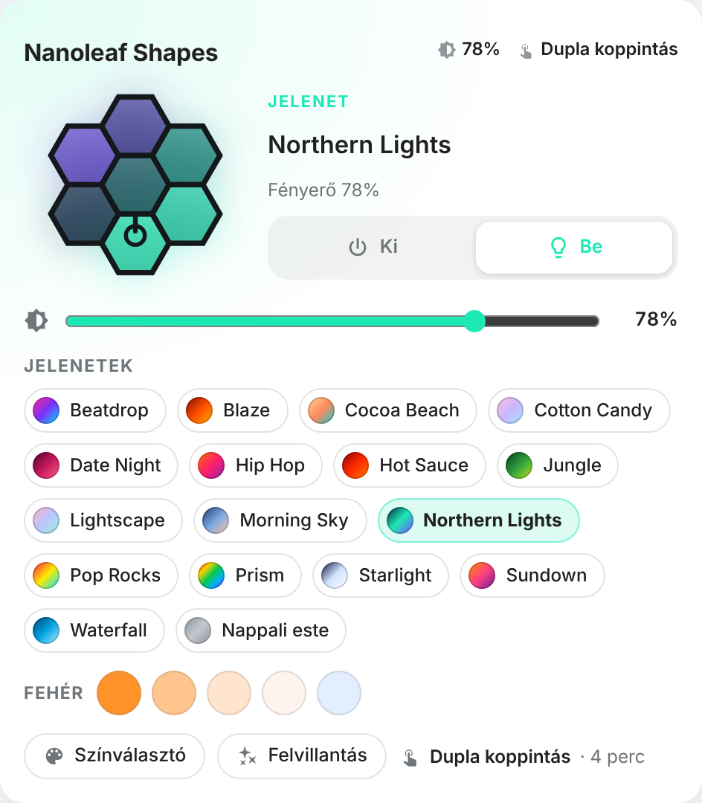 | 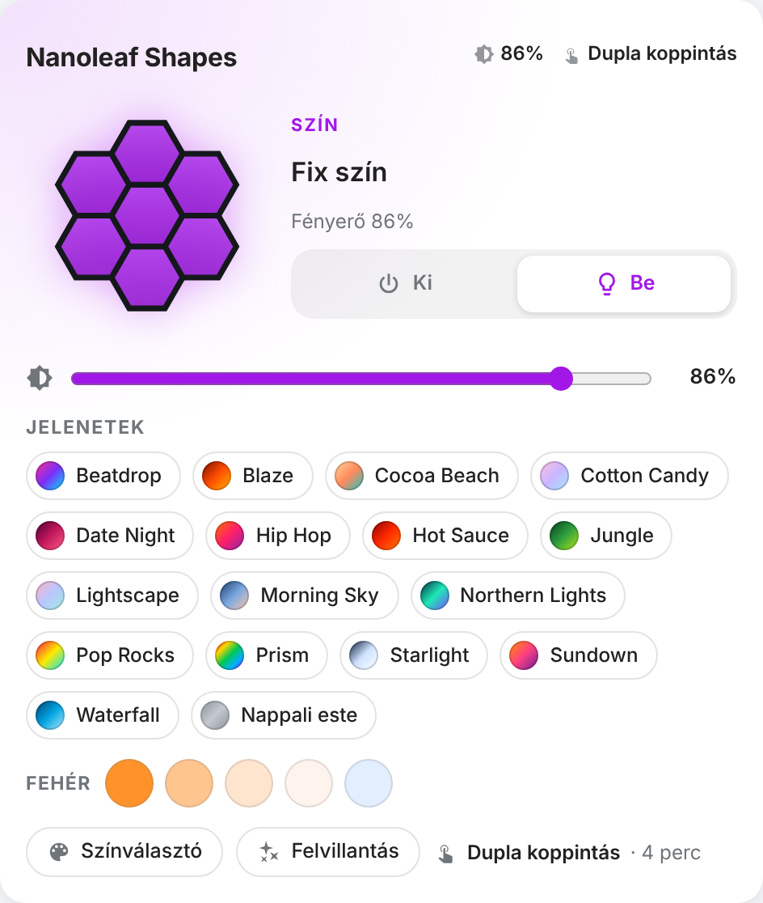 | 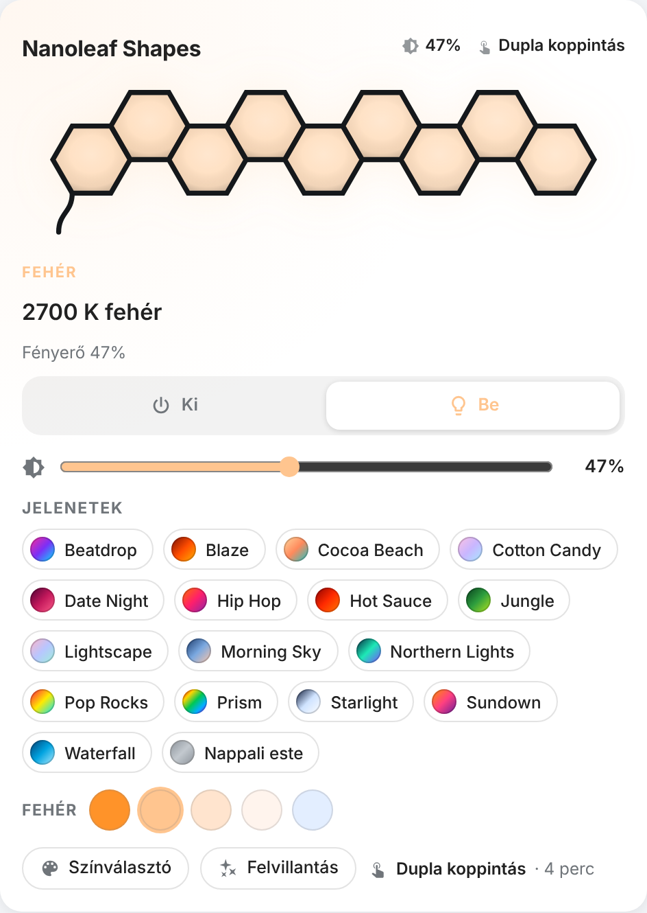 | 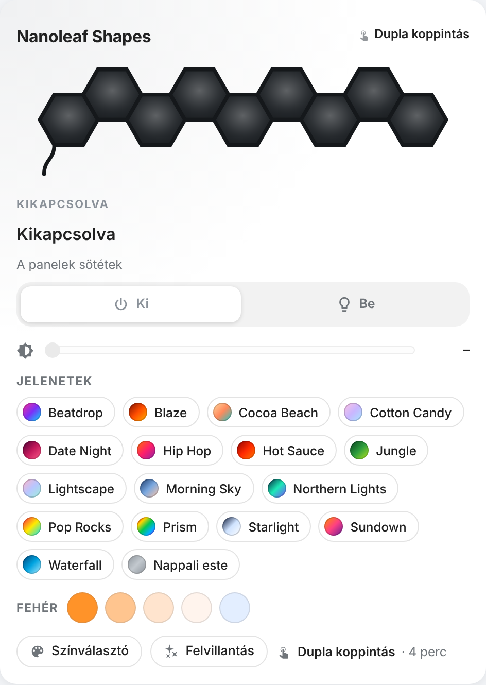 | 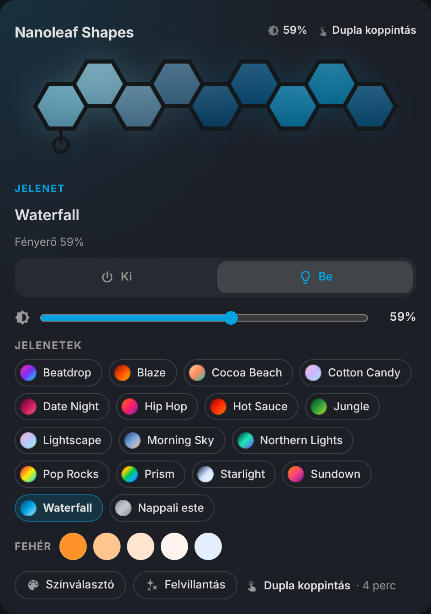 |

## Telepítés

> **Ez a repó privát.** A HACS hivatalosan csak publikus repókat támogat, ezért
> privát repónál a kézi telepítés a biztos út. (Ha később publikussá teszed a
> repót, a HACS-os mód is működik – lásd lentebb.)

### Kézzel (privát repónál ez ajánlott)

1. Töltsd le a `dist/ha-appliance-cards.js` fájlt – ez tartalmazza mind a
   tíz kártyát. (Ha csak egy kell: `dist/aeg-dishwasher-card.js`,
   `dist/philips-airfryer-card.js`, `dist/skoda-car-card.js`,
   `dist/liebherr-fridge-card.js`, `dist/fisher-erv-card.js`,
   `dist/daikin-ac-card.js`, `dist/netatmo-heating-card.js`,
   `dist/netatmo-weather-card.js`, `dist/aeno-heater-card.js`, illetve
   `dist/nanoleaf-shapes-card.js`.)
   - GitHub böngészőből: a fájl oldalán **Download raw file**.
   - Vagy a Home Assistant gépén, személyes hozzáférési tokennel (fine-grained
     token, `Contents: Read` jogosultsággal az adott repóra):

     ```bash
     curl -L \
       -H "Authorization: Bearer <GITHUB_TOKEN>" \
       -H "Accept: application/vnd.github.raw" \
       -o /config/www/ha-appliance-cards.js \
       "https://api.github.com/repos/gabor-io/ha-appliance-custom-card/contents/dist/ha-appliance-cards.js?ref=main"
     ```

2. A fájl kerüljön a `config/www/` könyvtárba (ha még nincs, hozd létre); ez a
   `/local/` útvonalon érhető el.
3. Beállítások → Irányítópultok → ⋮ (jobb felül) → **Erőforrások** → jobb alul
   **+ Erőforrás hozzáadása**:
   - URL: `/local/ha-appliance-cards.js?v=1`
   - Típus: **JavaScript modul**
4. Ctrl+F5 (vagy Cmd+Shift+R) a böngészőben.

Frissítéskor töltsd le újra a fájlt, és növeld az erőforrás URL végén a `?v=`
értéket (`?v=2`, `?v=3`, …), hogy a böngésző ne a régi verziót töltse be.
A letöltést a [`scripts/update-card.sh`](scripts/update-card.sh) automatizálja –
lásd a következő szakaszt.

### HACS (ha publikussá teszed a repót)

1. HACS → ⋮ → **Custom repositories**
2. URL: `https://github.com/gabor-io/ha-appliance-custom-card`, típus: **Dashboard**
3. Telepítés után a HACS magától felveszi a `ha-appliance-cards.js` erőforrást.

### Automatikus frissítés a GitHubról

A [`scripts/update-card.sh`](scripts/update-card.sh) letölti a repóból az aktuális
buildet a Home Assistant `www` mappájába. Privát repónál kell hozzá egy
fine-grained GitHub token (`Contents: Read` az adott repóra), publikusnál token
nélkül is megy.

```bash
GITHUB_TOKEN=github_pat_... ./scripts/update-card.sh
```

Amit tud:

- csak akkor tölt le, ha a fájl tényleg változott (a blob SHA-ját eltárolja a
  cél mellé `.sha` néven), így időzítve is nyugodtan futtatható;
- `--ref latest` esetén a legutóbbi GitHub Release-t húzza le (ha nincs release,
  a `main` branchre esik vissza), `--ref main` (alapértelmezés) mindig a legfrissebb állapotot;
- a letöltést ellenőrzi, és csak ép fájlt tesz a helyére – félbeszakadt letöltés
  soha nem írja felül a működő kártyát;
- `--file`, `--dest`, `--repo`, `--quiet` kapcsolókkal testre szabható
  (mindegyik megadható környezeti változóként is: `REPO`, `REF`, `FILE`, `DEST`,
  `GITHUB_TOKEN`).

**Időzítés a Docker hoston** (HA Container telepítésnél ez a legegyszerűbb) –
`crontab -e`:

```
0 4 * * * GITHUB_TOKEN=github_pat_... /opt/ha/update-card.sh --quiet --dest /path/to/ha-config/www/ha-appliance-cards.js
```

**Vagy magából a Home Assistantból**, `secrets.yaml`:

```yaml
update_cards_cmd: "GITHUB_TOKEN=github_pat_... /config/scripts/update-card.sh --quiet"
```

`configuration.yaml`:

```yaml
shell_command:
  update_appliance_cards: !secret update_cards_cmd
```

…majd egy automatizálás naponta (vagy HA indulásakor) hívja meg a
`shell_command.update_appliance_cards` műveletet. Előtte futtasd le kézzel a
Fejlesztői eszközök → Műveletek alatt: ha a konténerben nincs `curl`, a hostos
cron a megoldás.

Frissítés után a böngészőben Ctrl+F5, vagy növeld a Lovelace erőforrás URL-jében
a `?v=` értéket.

## Használat

A kártyák maguktól megkeresik a készülék entitásait:

```yaml
type: custom:aeg-dishwasher-card
```

```yaml
type: custom:philips-airfryer-card
```

```yaml
type: custom:skoda-car-card
```

```yaml
type: custom:liebherr-fridge-card
```

```yaml
type: custom:fisher-erv-card
```

```yaml
type: custom:daikin-ac-card
```

```yaml
type: custom:netatmo-heating-card
```

```yaml
type: custom:netatmo-weather-card
```

```yaml
type: custom:aeno-heater-card
```

```yaml
type: custom:nanoleaf-shapes-card
```

Ha több hasonló készüléked van, add meg a készüléket (a vizuális szerkesztő
legördülőjéből is választható):

```yaml
type: custom:philips-airfryer-card
device: 8f1c0a2b5d7e4f3a9c6b1d2e3f4a5b6c
name: Airfryer
```

## Beállítások

Közös opciók mindkét kártyán:

| Opció | Típus | Alapértelmezés | Leírás |
| --- | --- | --- | --- |
| `device` | string | automatikus | A készülék `device_id`-ja |
| `prefix` | string | automatikus | Az entitások közös előtagja |
| `entities` | map | automatikus | Egyedi entitás-hozzárendelés |
| `name` | string | a készülék neve | Fejléc felirat |
| `language` | `auto` \| `hu` \| `en` | `auto` | A kártya nyelve |
| `compact` | bool | `false` | Kisebb géprajz, sűrűbb elrendezés |
| `animate` | bool | `true` | Animációk ki/be |
| `show_details` | bool | `true` | Részletek rács |
| `show_controls` | bool | `true` | Vezérlőgombok |

Csak a mosogatógép kártyán: `show_programs`, `show_options`, `show_delay`,
`show_scores`, `show_consumption`, `show_appliance_settings`.

Csak az airfryer kártyán: `show_methods`, `show_presets`, `show_settings`,
`show_probe`.

Az `entities` alatt felülírható kulcsok a két `docs/*-capabilities.md` fájl
végén találhatók.

## Jó tudni

- **Mosogatógép távvezérlés**: a gép csak akkor fogadja a parancsokat, ha
  engedélyezett a távindítás; a kártya kiszürkíti a gombokat és jelzi az okot.
- **Program választása kikapcsolt mosogatógépen**: a kártya előbb megnyomja az
  `execute_command_on` gombot, vár 1,5 másodpercet, és utána állít programot.
- **Airfryer fiók**: nyitott fióknál a gép szünetel, a kártya nem enged indítást.
- **Mértékegységek**: a kártyák az entitások `unit_of_measurement` attribútumát
  követik, így °C/°F és perc/másodperc alapú érték is jó.

## Fejlesztés

```bash
npm install
npm run build      # dist/*.js (mindhárom bundle)
npm run watch      # figyelő mód, minifikálás nélkül
npm run serve      # http://localhost:8099/demo/ – demók mock hass-szal
```

```
src/
├── shared/      # entitásfelismerés, i18n, ikonok, alapstílusok, szerkesztő
├── dishwasher/  # AEG / Electrolux mosogatógép kártya
└── airfryer/    # Philips airfryer kártya
```

### Kiadás (release)

A verziószám egyetlen helyen él: a `package.json`-ben. A build innen veszi a
bundle fejlécét és a kártyák konzolra írt verzióját is.

Új kiadáshoz csak a verziót kell emelni:

1. `package.json` → `"version": "1.2.0"`
2. `npm run build` (a `dist/` a repóban van, a HACS ezt tölti le)
3. commit + merge a `main`-re

A `.github/workflows/release.yml` innentől automatikus: ha a `main`-en változik
a `package.json`, létrehozza a `v1.2.0` taget és a hozzá tartozó GitHub
Release-t, csatolja a három bundle-t, és a kiadási jegyzeteket a commitokból
generálja. Ha a `dist/` nincs újraépítve, a workflow hibával leáll – így nem
kerülhet ki olyan release, amiben a lefordított fájl elavult. Kézzel is
indítható a Actions fülön (**Run workflow**).

A HACS a GitHub Release-eket látja verzióként, tehát minden ilyen kiadás után
megjelenik a frissítés a HACS-ban.

A `demo/` mappa a valódi diagnosztikai adatokból épített állapotokat játssza
vissza (mosogatógép: fut, szárít, szünetel, késleltetve indul, elkészült, hiba,
offline; airfryer: előmelegít, süt, rázás, nyitott fiók, ételhőmérő, párolás,
elkészült, melegen tart, hiba), így a kártyák HA nélkül is fejleszthetők.

## Licenc

MIT
